# METAcraft Season 6 seed search

World generation: Minecraft 26.3, Fabric Loader 0.19.5, Fabric API 0.161.0+26.3, Tectonic 3.0.31, Lithostitched 2.0.4, default `config/tectonic.json`, plus the **Metacraft** datapack (in [`../datapack/Metacraft`](../datapack/Metacraft)) loaded above Tectonic. All biomes, heights and structures below come from that exact worldgen, computed inside a real 26.3 dedicated server (see [`../README.md`](../README.md) for how).

Searched **12000 seeds** (pass 1: biomes on a 64-block grid, 2209 candidate centres each, 45 min on 4 cores), then **260 candidates** in detail (pass 2: 16-block grid, heights, valleys, exact structure starts, centre refined to 64 blocks), then the top 10 with real terrain heights, and the top 6 verified with `/locate` in a real server.

Border stages: **start** = 1000 wide, **stage 2** = 1500 wide (+250 gold blocks), **stage 3** = 2000 wide (+500 gold blocks). "In stage 2" below means newly reachable in stage 2 (not already in the start).

## Top 10

| # | seed | border centre (spawn) | score | ocean in start | biomes/wood: start | + stage 2 | + stage 3 | structures: start | + stage 2 | + stage 3 | nearest stronghold | valleys (stage 2) |
|---|---|---|---|---|---|---|---|---|---|---|---|---|
| 1 | `-2490713400371329797` | -4160, -1600 | 23.6 | 16% | oak, birch, spruce, dark oak, jungle, acacia, cherry, pale oak, snow/ice, ocean, peaks, lush caves, deep dark | dripstone | – | 1 villages, 1 trial ch., 4 anc. city, jungle temple, trail ruins | 1 villages, 3 trial ch., 2 anc. city | 2 villages, 4 trial ch., 3 anc. city, jungle temple | 328 blocks (start) | 16% |
| 2 | `-3798611108748814191` | -5504, 1280 | 23.4 | 0% | oak, birch, spruce, dark oak, jungle, acacia, cherry, pale oak, snow/ice, peaks, lush caves, deep dark | dripstone | ocean | 1 villages, 2 trial ch., 6 anc. city, outpost, mansion, trail ruins | 1 villages, 4 trial ch., 5 anc. city, jungle temple | 1 villages, 4 trial ch., 1 anc. city | 542 blocks (stage 2) | 18% |
| 3 | `1555912076825267547` | -5184, -4032 | 23.3 | 0% | oak, birch, spruce, dark oak, jungle, acacia, cherry, pale oak, badlands, snow/ice, peaks, deep dark, dripstone | desert, ocean, lush caves | – | 1 villages, 2 trial ch., 2 anc. city | 1 villages, 5 trial ch., 1 anc. city, jungle temple, igloo | 1 villages, 3 trial ch., 3 anc. city, desert temple, mansion, trail ruins | 2204 blocks (outside) | 19% |
| 4 | `4127421199368335624` | 1664, 2240 | 23.1 | 0% | oak, birch, spruce, dark oak, jungle, acacia, cherry, pale oak, snow/ice, peaks, deep dark, dripstone | – | desert, badlands, lush caves | 2 villages, 2 trial ch., 4 anc. city, jungle temple, outpost, trail ruins | 1 villages, 1 trial ch., 4 anc. city, jungle temple, outpost, mansion, trail ruins | 3 trial ch., 6 anc. city, jungle temple, trail ruins, igloo | 376 blocks (start) | 28% |
| 5 | `2459899889739035294` | -4288, -1280 | 23.1 | 0% | oak, birch, spruce, dark oak, jungle, acacia, cherry, pale oak, snow/ice, peaks, lush caves, deep dark, dripstone | – | desert, ocean | 2 villages, 1 trial ch., 2 anc. city | 1 villages, 2 trial ch., 5 anc. city, jungle temple, trail ruins, igloo | 1 villages, 3 trial ch., 7 anc. city, jungle temple, outpost, trail ruins | 334 blocks (start) | 16% |
| 6 | `-8503562548022272150` | 1856, 448 | 23.1 | 0% | oak, birch, spruce, dark oak, jungle, acacia, mangrove, cherry, snow/ice, swamp, peaks, lush caves, deep dark, dripstone | – | – | 1 villages, 2 trial ch., 1 anc. city, trail ruins | 1 villages, 3 trial ch., 2 anc. city, jungle temple, outpost | 1 villages, 4 trial ch., 2 anc. city, jungle temple, trail ruins, swamp hut | 726 blocks (stage 2) | 14% |
| 7 | `7449177655716424266` | 4800, -1728 | 23.1 | 12% | oak, birch, spruce, dark oak, acacia, cherry, pale oak, snow/ice, ocean, peaks, lush caves, deep dark, dripstone | – | jungle | 2 villages, 1 trial ch., 3 anc. city, outpost, monument | 1 villages, 1 trial ch., 5 anc. city | 1 villages, 5 trial ch., 4 anc. city, trail ruins | 284 blocks (start) | 17% |
| 8 | `7737677442817758369` | -1856, 64 | 22.8 | 0% | oak, birch, spruce, jungle, acacia, cherry, pale oak, snow/ice, peaks, lush caves, deep dark, dripstone | dark oak | – | 1 villages, 2 trial ch., 4 anc. city, jungle temple | 1 villages, 3 trial ch., 1 anc. city, outpost, mansion | 1 villages, 4 trial ch., 3 anc. city, jungle temple, trail ruins, igloo | 466 blocks (start) | 20% |
| 9 | `-5650971143841759832` | 2496, 192 | 22.6 | 6% | oak, birch, spruce, dark oak, jungle, acacia, cherry, pale oak, snow/ice, ocean, peaks, lush caves, deep dark | dripstone | – | 1 villages, 3 trial ch., 5 anc. city, trail ruins | 1 villages, 1 trial ch., 3 anc. city | 1 villages, 6 trial ch., 2 anc. city, monument | 716 blocks (stage 2) | 18% |
| 10 | `930229584108551678` | -3648, -4032 | 22.5 | 1% | oak, birch, spruce, dark oak, acacia, cherry, pale oak, snow/ice, ocean, peaks, lush caves, deep dark, dripstone | – | – | 2 villages, 1 trial ch., 4 anc. city, trail ruins | 2 villages, 1 trial ch., 4 anc. city, outpost | 3 trial ch., 7 anc. city, trail ruins | 549 blocks (start) | 19% |

Missing from all three stages is what is not listed. Wood types: oak, birch, spruce, dark oak, jungle, acacia, mangrove, cherry, pale oak (pale garden). Score = biome categories (weighted, start 1.0 / stage 2 0.6 / stage 3 0.25) + structures + valleys + terrain variety − ocean penalty; see [`../README.md`](../README.md).

## 1. Seed `-2490713400371329797`, centre -4160, -1600

Stronghold 240 blocks from the centre (inside the start), plus a village, an ancient city, trail ruins and a jungle temple, all inside the start. 9 wood types reachable except mangrove, plus lush caves, deep dark and dripstone under the start. The only snow is on the peaks. Desert (~2340) and badlands (~2500) lie outside stage 3.

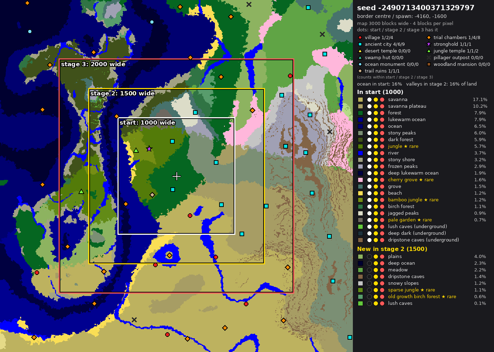

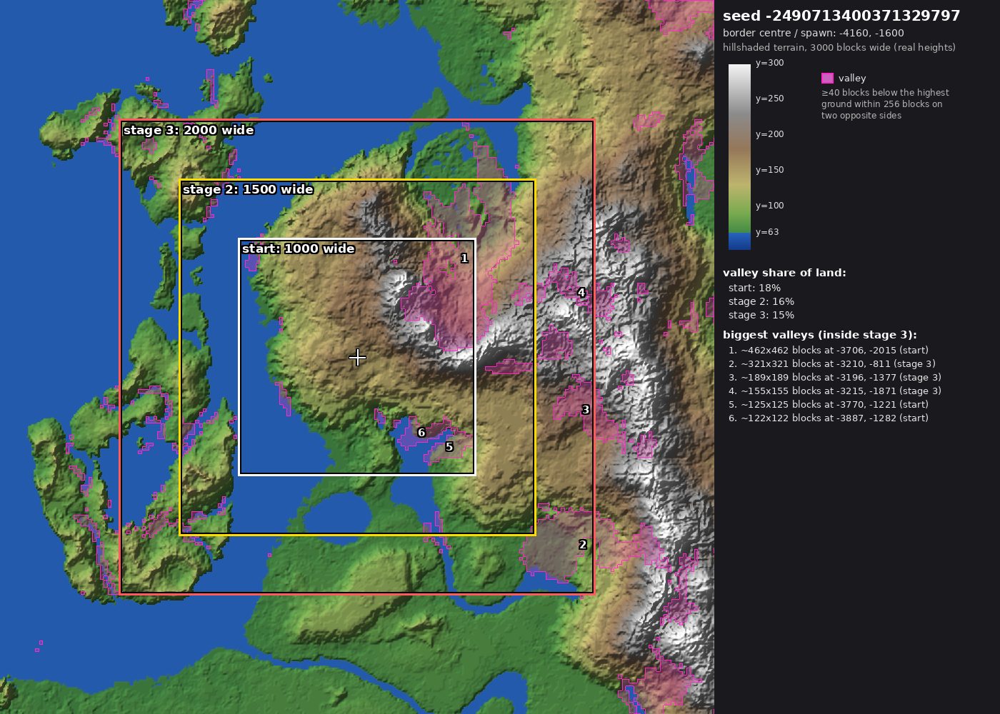

Context map, 8000 blocks wide

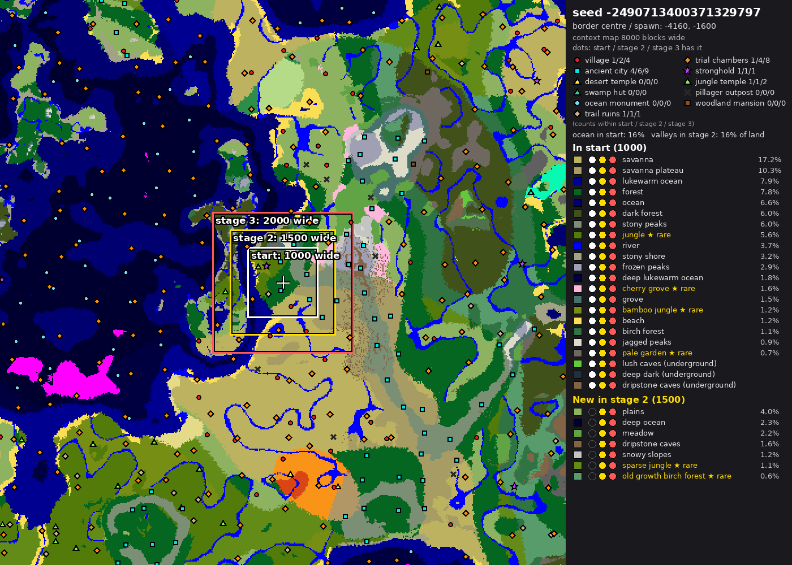

Biggest valleys: ~462×462 blocks at -3706, -2015 (start); ~321×321 blocks at -3210, -811 (stage 3); ~189×189 blocks at -3196, -1377 (stage 3); ~155×155 blocks at -3215, -1871 (stage 3). Valley share of land: start 18%, stage 2 16%, stage 3 15%.

Terrain types in stage 2: lowland, hills, plateau, peaks, coast.

**Verified in a real server** (`/locate` from -4160, ~, -1600; datapacks: [vanilla (built-in)], [fabric-convention-tags-v2 (Fabric mod)], [lithostitched (Fabric mod)], [tectonic:tectonic (built-in: Tectonic)], [file/Metacraft (world)] There are no more data packs available):

| locate | result | Chebyshev distance | stage |
|---|---|---|---|
| structure `#village` | -4048, -1248 | 352 | start |
| structure `trial_chambers` | -4704, -2096 | 544 | stage 2 |
| structure `ancient_city` | -4192, -1872 | 272 | start |
| structure `stronghold` | -4400, -1840 | 240 | start |
| structure `mansion` | -2112, -4560 | 2960 | outside |
| structure `monument` | -5408, -2832 | 1248 | outside |
| structure `desert_pyramid` | -4064, 1104 | 2704 | outside |
| structure `jungle_pyramid` | -4512, -1824 | 352 | start |
| structure `pillager_outpost` | -3536, -3072 | 1472 | outside |
| structure `trail_ruins` | -4352, -1440 | 192 | start |
| structure `swamp_hut` | -656, -2880 | 3504 | outside |
| structure `igloo` | 1648, 784 | 5808 | outside |
| biome `plains` | -3680, -2080 | 480 | start |
| biome `forest` | -4160, -1600 | 0 | start |
| biome `birch_forest` | -3904, -2080 | 480 | start |
| biome `taiga` | 416, 576 | 4576 | outside |
| biome `dark_forest` | -4544, -1984 | 384 | start |
| biome `jungle` | -4288, -1696 | 128 | start |
| biome `bamboo_jungle` | -4352, -1728 | 192 | start |
| biome `savanna` | -4032, -1440 | 160 | start |
| biome `mangrove_swamp` | not found | – | – |
| biome `cherry_grove` | -3744, -1952 | 416 | start |
| biome `pale_garden` | -4416, -2016 | 416 | start |
| biome `desert` | -3776, 736 | 2336 | outside |
| biome `badlands` | -3360, 896 | 2496 | outside |
| biome `eroded_badlands` | -3008, -7808 | 6208 | outside |
| biome `wooded_badlands` | -3232, 1120 | 2720 | outside |
| biome `snowy_plains` | 1536, 800 | 5696 | outside |
| biome `ice_spikes` | not found | – | – |
| biome `snowy_taiga` | 1888, 2432 | 6048 | outside |
| biome `swamp` | -1376, -2656 | 2784 | outside |
| biome `ocean` | -4640, -1952 | 480 | start |
| biome `jagged_peaks` | -4096, -2048 | 448 | start |
| biome `frozen_peaks` | -3872, -1920 | 320 | start |
| biome `stony_peaks` | -4032, -1696 | 128 | start |
| biome `meadow` | -3456, -2272 | 704 | stage 2 |
| biome `mushroom_fields` | -6080, -3392 | 1920 | outside |
| biome `lush_caves` | -4288, -1728 | 128 | start |
| biome `deep_dark` | -4160, -1600 | 0 | start |
| biome `dripstone_caves` | -4000, -1728 | 160 | start |

Screenshots (render distance 12, FOV 70, noon, no HUD):

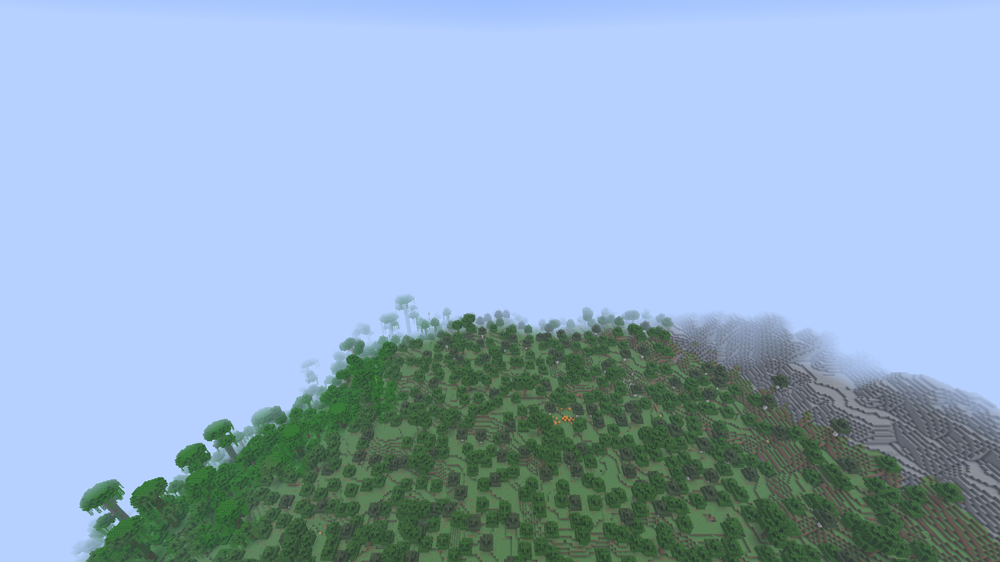

## 2. Seed `-3798611108748814191`, centre -5504, 1280

Stronghold (496) and woodland mansion (480) inside the start, plus an ancient city, trial chambers, an outpost and trail ruins nearby. Every wood type except mangrove (2560) within stage 2, and 0% ocean. Desert and badlands are 1200–1800 blocks out; no snowy plains, only snowy peaks.

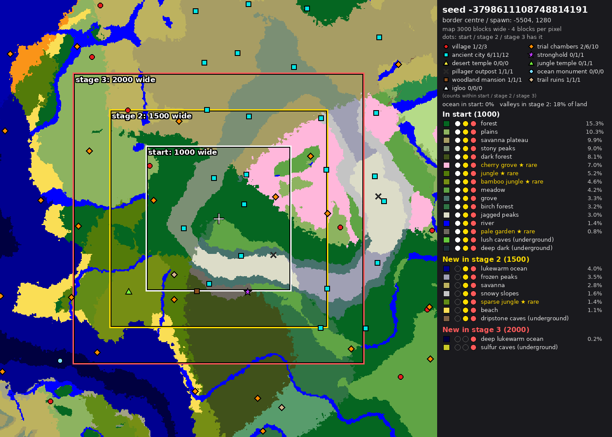

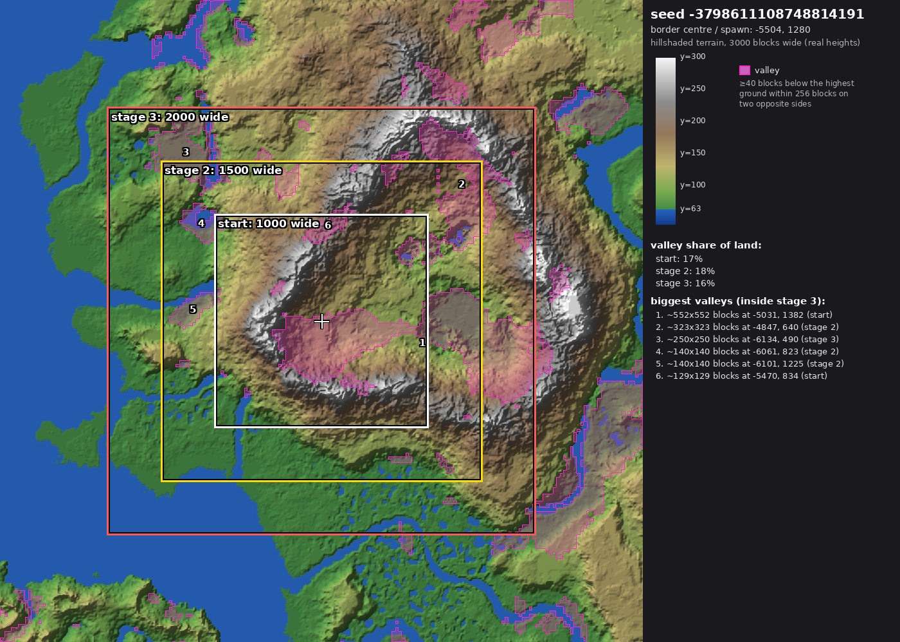

Context map, 8000 blocks wide

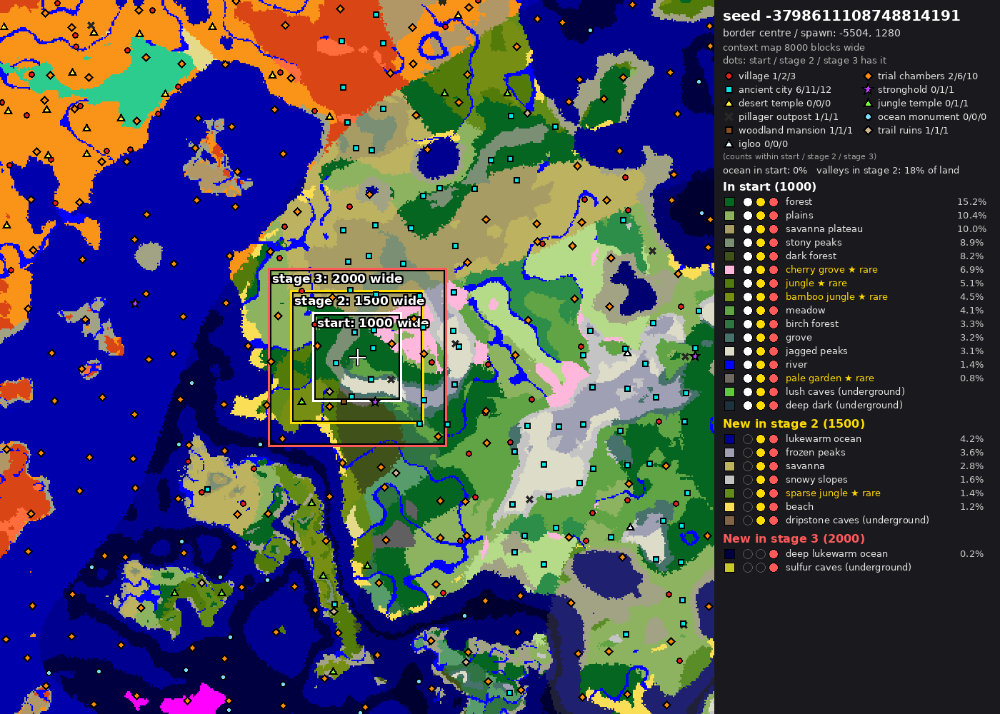

Biggest valleys: ~552×552 blocks at -5031, 1382 (start); ~323×323 blocks at -4847, 640 (stage 2); ~250×250 blocks at -6134, 490 (stage 3); ~140×140 blocks at -6061, 823 (stage 2). Valley share of land: start 17%, stage 2 18%, stage 3 16%.

Terrain types in stage 2: lowland, hills, plateau, peaks, coast.

**Verified in a real server** (`/locate` from -5504, ~, 1280; datapacks: [vanilla (built-in)], [fabric-convention-tags-v2 (Fabric mod)], [lithostitched (Fabric mod)], [tectonic:tectonic (built-in: Tectonic)], [file/Metacraft (world)] There are no more data packs available):

| locate | result | Chebyshev distance | stage |
|---|---|---|---|
| structure `#village` | -6128, 544 | 736 | stage 2 |
| structure `trial_chambers` | -5984, 1168 | 480 | start |
| structure `ancient_city` | -5744, 1344 | 240 | start |
| structure `stronghold` | -5312, 1776 | 496 | start |
| structure `mansion` | -5632, 1760 | 480 | start |
| structure `monument` | -6592, 2256 | 1088 | outside |
| structure `desert_pyramid` | -8160, -1408 | 2688 | outside |
| structure `jungle_pyramid` | -6128, 1776 | 624 | stage 2 |
| structure `pillager_outpost` | -5120, 1536 | 384 | start |
| structure `trail_ruins` | -5824, 1664 | 384 | start |
| structure `swamp_hut` | -12432, -14144 | 15424 | outside |
| structure `igloo` | -2480, 1232 | 3024 | outside |
| biome `plains` | -5088, 1024 | 416 | start |
| biome `forest` | -5504, 1280 | 0 | start |
| biome `birch_forest` | -5568, 1344 | 64 | start |
| biome `taiga` | -640, 3552 | 4864 | outside |
| biome `dark_forest` | -5696, 1664 | 384 | start |
| biome `jungle` | -5760, 1536 | 256 | start |
| biome `bamboo_jungle` | -5856, 1632 | 352 | start |
| biome `savanna` | -6112, 672 | 608 | stage 2 |
| biome `mangrove_swamp` | -7968, -1280 | 2560 | outside |
| biome `cherry_grove` | -5248, 1024 | 256 | start |
| biome `pale_garden` | -5664, 1632 | 352 | start |
| biome `desert` | -6688, 96 | 1184 | outside |
| biome `badlands` | -6848, -672 | 1952 | outside |
| biome `eroded_badlands` | -5568, -1344 | 2624 | outside |
| biome `wooded_badlands` | -6944, -544 | 1824 | outside |
| biome `snowy_plains` | not found | – | – |
| biome `ice_spikes` | not found | – | – |
| biome `snowy_taiga` | not found | – | – |
| biome `swamp` | not found | – | – |
| biome `ocean` | -4032, 3680 | 2400 | outside |
| biome `jagged_peaks` | -5600, 1504 | 224 | start |
| biome `frozen_peaks` | -5664, 1472 | 192 | start |
| biome `stony_peaks` | -5600, 1184 | 96 | start |
| biome `meadow` | -5472, 1312 | 32 | start |
| biome `mushroom_fields` | -7200, 4960 | 3680 | outside |
| biome `lush_caves` | -5696, 1504 | 224 | start |
| biome `deep_dark` | -5504, 1280 | 0 | start |
| biome `dripstone_caves` | -5440, 1280 | 64 | start |

## 3. Seed `1555912076825267547`, centre -5184, -4032

Best climate spread: badlands and eroded badlands (gold) in the start, desert at 640, plus savanna, jungle, bamboo, cherry, pale garden and three kinds of peaks, all within the start. Village 256, ancient city 368 and trial chambers in the start. Weak spots: the stronghold is ~1900 blocks out, and there is no mangrove or snowy plains nearby.

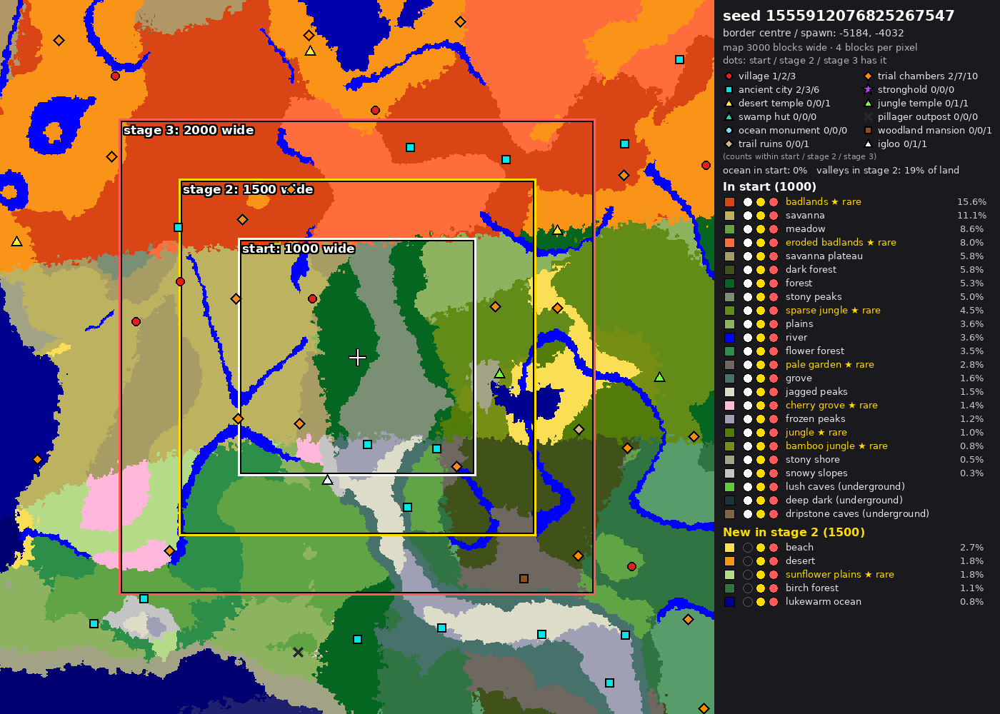

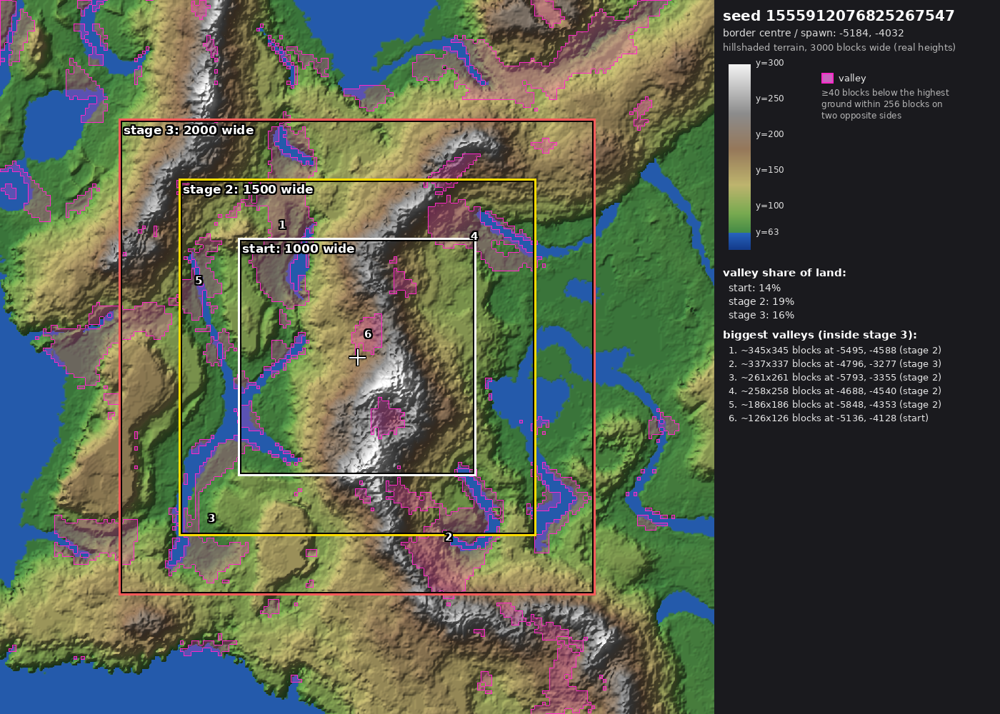

Context map, 8000 blocks wide

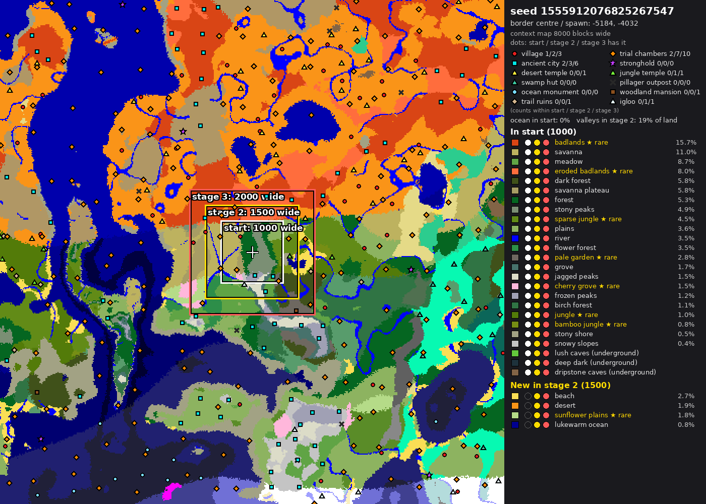

Biggest valleys: ~345×345 blocks at -5495, -4588 (stage 2); ~337×337 blocks at -4796, -3277 (stage 3); ~261×261 blocks at -5793, -3355 (stage 2); ~258×258 blocks at -4688, -4540 (stage 2). Valley share of land: start 14%, stage 2 19%, stage 3 16%.

Terrain types in stage 2: lowland, hills, plateau, peaks, coast.

**Verified in a real server** (`/locate` from -5184, ~, -4032; datapacks: [vanilla (built-in)], [fabric-convention-tags-v2 (Fabric mod)], [lithostitched (Fabric mod)], [tectonic:tectonic (built-in: Tectonic)], [file/Metacraft (world)] There are no more data packs available):

| locate | result | Chebyshev distance | stage |
|---|---|---|---|
| structure `#village` | -5376, -4288 | 256 | start |
| structure `trial_chambers` | -5664, -4576 | 544 | stage 2 |
| structure `ancient_city` | -5136, -3664 | 368 | start |
| structure `stronghold` | -6288, -5952 | 1920 | outside |
| structure `mansion` | -4464, -3120 | 912 | stage 3 |
| structure `monument` | -7600, -1312 | 2720 | outside |
| structure `desert_pyramid` | -6624, -4528 | 1440 | outside |
| structure `jungle_pyramid` | -4592, -3968 | 592 | stage 2 |
| structure `pillager_outpost` | -5424, -2784 | 1248 | outside |
| structure `trail_ruins` | -4240, -3728 | 944 | stage 3 |
| structure `swamp_hut` | -2320, -3520 | 2864 | outside |
| structure `igloo` | -5312, -3520 | 512 | stage 2 |
| biome `plains` | -5344, -4064 | 160 | start |
| biome `forest` | -5184, -4032 | 0 | start |
| biome `birch_forest` | -4832, -3680 | 352 | start |
| biome `taiga` | -5056, -2496 | 1536 | outside |
| biome `dark_forest` | -4736, -3680 | 448 | start |
| biome `jungle` | -4832, -3776 | 352 | start |
| biome `bamboo_jungle` | -4768, -3840 | 416 | start |
| biome `savanna` | -5376, -4064 | 192 | start |
| biome `mangrove_swamp` | -2528, -4288 | 2656 | outside |
| biome `cherry_grove` | -5344, -3680 | 352 | start |
| biome `pale_garden` | -4800, -3648 | 384 | start |
| biome `desert` | -5632, -4672 | 640 | stage 2 |
| biome `badlands` | -5632, -4480 | 448 | start |
| biome `eroded_badlands` | -5344, -4512 | 480 | start |
| biome `wooded_badlands` | -6016, -5408 | 1376 | outside |
| biome `snowy_plains` | -1792, -480 | 3552 | outside |
| biome `ice_spikes` | -2240, -416 | 3616 | outside |
| biome `snowy_taiga` | -1056, -128 | 4128 | outside |
| biome `swamp` | -2720, -1600 | 2464 | outside |
| biome `ocean` | -5792, -2784 | 1248 | outside |
| biome `jagged_peaks` | -4928, -3680 | 352 | start |
| biome `frozen_peaks` | -5056, -3712 | 320 | start |
| biome `stony_peaks` | -5120, -4000 | 64 | start |
| biome `meadow` | -4864, -3648 | 384 | start |
| biome `mushroom_fields` | -6432, -384 | 3648 | outside |
| biome `lush_caves` | -4896, -3872 | 288 | start |
| biome `deep_dark` | -5184, -4032 | 0 | start |
| biome `dripstone_caves` | -5120, -3968 | 64 | start |

## 4. Seed `4127421199368335624`, centre 1664, 2240

Everything packed close: village, ancient city, trial chambers, jungle temple, outpost and trail ruins within 330 blocks, stronghold at 384, and the most valley ground of the finalists (28% of stage 2). Badlands at ~1250, desert at ~900; no mangrove.

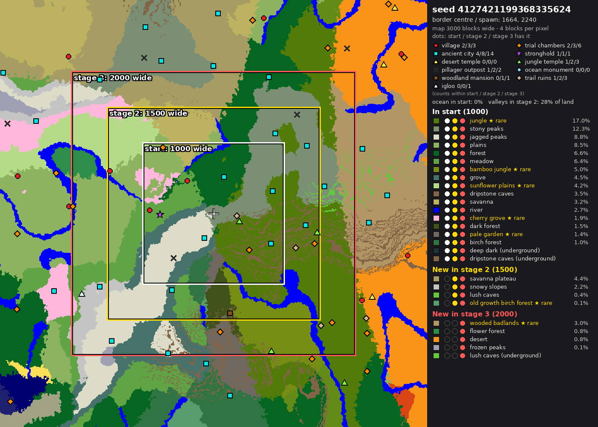

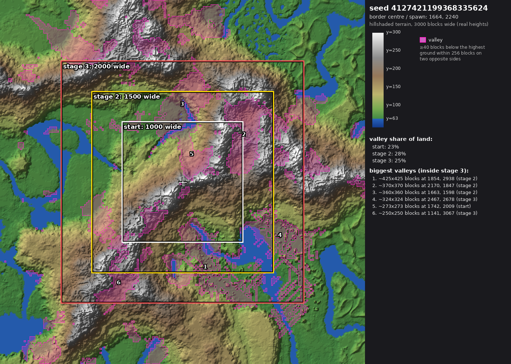

Context map, 8000 blocks wide

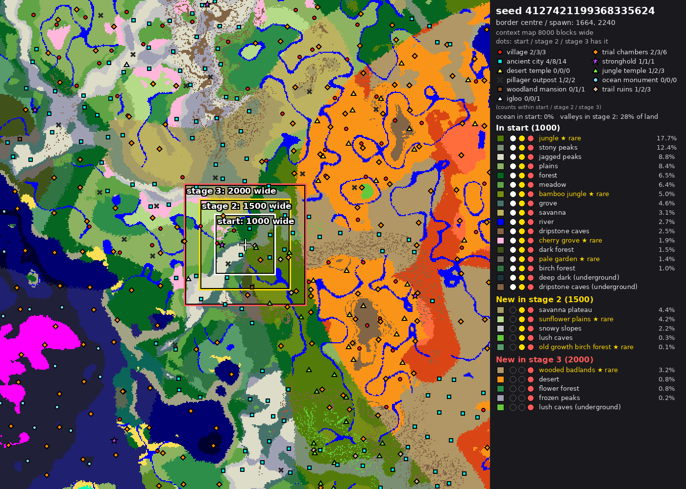

Biggest valleys: ~425×425 blocks at 1854, 2938 (stage 2); ~370×370 blocks at 2170, 1847 (stage 2); ~360×360 blocks at 1663, 1598 (stage 2); ~324×324 blocks at 2467, 2678 (stage 3). Valley share of land: start 23%, stage 2 28%, stage 3 25%.

Terrain types in stage 2: lowland, hills, peaks.

**Verified in a real server** (`/locate` from 1664, ~, 2240; datapacks: [vanilla (built-in)], [fabric-convention-tags-v2 (Fabric mod)], [lithostitched (Fabric mod)], [tectonic:tectonic (built-in: Tectonic)], [file/Metacraft (world)] There are no more data packs available):

| locate | result | Chebyshev distance | stage |
|---|---|---|---|
| structure `#village` | 1488, 2016 | 224 | start |
| structure `trial_chambers` | 1904, 2512 | 272 | start |
| structure `ancient_city` | 1760, 1984 | 256 | start |
| structure `stronghold` | 1280, 2240 | 384 | start |
| structure `mansion` | 1744, 2944 | 704 | stage 2 |
| structure `monument` | -736, 3936 | 2400 | outside |
| structure `desert_pyramid` | 2848, 1184 | 1184 | outside |
| structure `jungle_pyramid` | 1840, 2288 | 176 | start |
| structure `pillager_outpost` | 1376, 2560 | 320 | start |
| structure `trail_ruins` | 1840, 2256 | 176 | start |
| structure `swamp_hut` | 1232, 7856 | 5616 | outside |
| structure `igloo` | 736, 2800 | 928 | stage 3 |
| biome `plains` | 1376, 1952 | 288 | start |
| biome `forest` | 1632, 2176 | 64 | start |
| biome `birch_forest` | 1632, 2560 | 320 | start |
| biome `taiga` | -32, 3936 | 1696 | outside |
| biome `dark_forest` | 1728, 2624 | 384 | start |
| biome `jungle` | 1760, 2176 | 96 | start |
| biome `bamboo_jungle` | 1760, 2624 | 384 | start |
| biome `savanna` | 1472, 1888 | 352 | start |
| biome `mangrove_swamp` | not found | – | – |
| biome `cherry_grove` | 1408, 1984 | 256 | start |
| biome `pale_garden` | 1664, 2496 | 256 | start |
| biome `desert` | 2560, 1376 | 896 | stage 3 |
| biome `badlands` | 2912, 3456 | 1248 | outside |
| biome `eroded_badlands` | 4480, 3168 | 2816 | outside |
| biome `wooded_badlands` | 2496, 1472 | 832 | stage 3 |
| biome `snowy_plains` | 544, 7520 | 5280 | outside |
| biome `ice_spikes` | -1056, 7232 | 4992 | outside |
| biome `snowy_taiga` | 736, 7520 | 5280 | outside |
| biome `swamp` | -896, 6208 | 3968 | outside |
| biome `ocean` | 480, 3424 | 1184 | outside |
| biome `jagged_peaks` | 1632, 2240 | 32 | start |
| biome `frozen_peaks` | 928, 3200 | 960 | stage 3 |
| biome `stony_peaks` | 1664, 2240 | 0 | start |
| biome `meadow` | 1568, 2176 | 96 | start |
| biome `mushroom_fields` | -1024, 3872 | 2688 | outside |
| biome `lush_caves` | 2144, 1824 | 480 | start |
| biome `deep_dark` | 1664, 2240 | 0 | start |
| biome `dripstone_caves` | 1664, 2240 | 0 | start |

## 5. Seed `2459899889739035294`, centre -4288, -1280

Trial chambers at 144 and stronghold at 320 (start), a village at 336, and desert at ~930. Meadow and forest at the centre. No swamp within locate range, and mangrove is far.

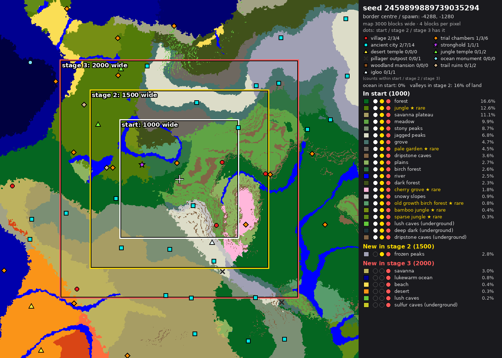

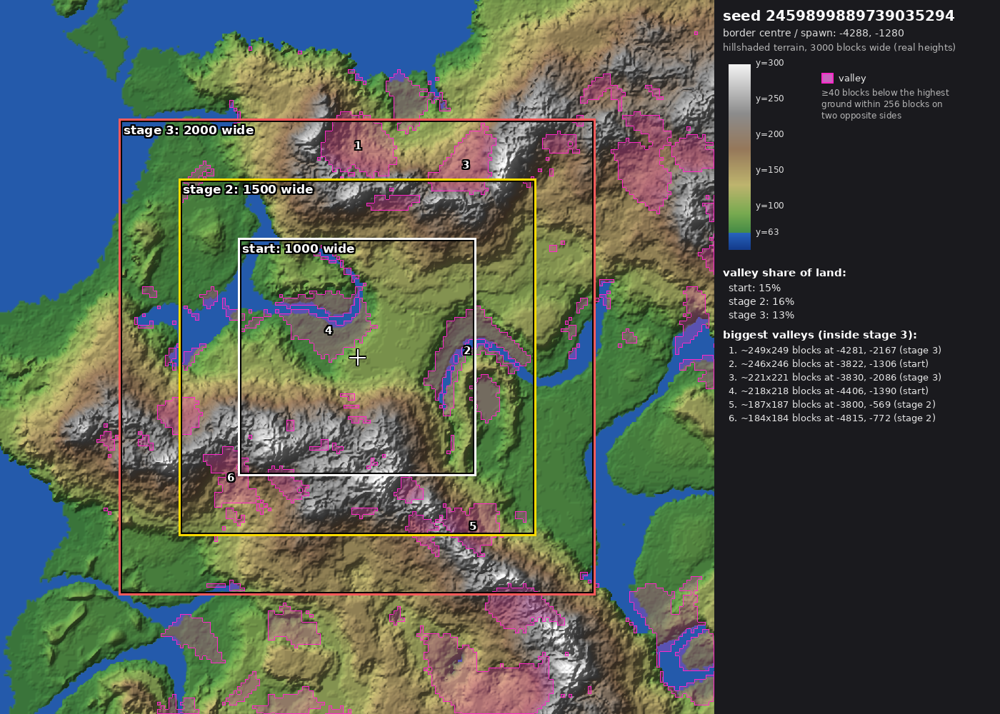

Context map, 8000 blocks wide

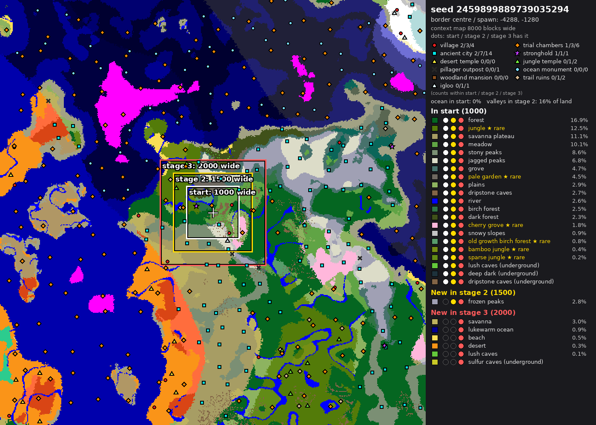

Biggest valleys: ~249×249 blocks at -4281, -2167 (stage 3); ~246×246 blocks at -3822, -1306 (start); ~221×221 blocks at -3830, -2086 (stage 3); ~218×218 blocks at -4406, -1390 (start). Valley share of land: start 15%, stage 2 16%, stage 3 13%.

Terrain types in stage 2: lowland, hills, plateau, peaks.

**Verified in a real server** (`/locate` from -4288, ~, -1280; datapacks: [vanilla (built-in)], [fabric-convention-tags-v2 (Fabric mod)], [lithostitched (Fabric mod)], [tectonic:tectonic (built-in: Tectonic)], [file/Metacraft (world)] There are no more data packs available):

| locate | result | Chebyshev distance | stage |
|---|---|---|---|
| structure `#village` | -3952, -1424 | 336 | start |
| structure `trial_chambers` | -4272, -1424 | 144 | start |
| structure `ancient_city` | -4816, -1120 | 528 | stage 2 |
| structure `stronghold` | -4608, -1408 | 320 | start |
| structure `mansion` | -7184, -5856 | 4576 | outside |
| structure `monument` | -5536, -2256 | 1248 | outside |
| structure `desert_pyramid` | -5536, -224 | 1248 | outside |
| structure `jungle_pyramid` | -4976, -1744 | 688 | stage 2 |
| structure `pillager_outpost` | -3920, -512 | 768 | stage 3 |
| structure `trail_ruins` | -4896, -1360 | 608 | stage 2 |
| structure `swamp_hut` | 2560, -4800 | 6848 | outside |
| structure `igloo` | -4016, -752 | 528 | stage 2 |
| biome `plains` | -4032, -1152 | 256 | start |
| biome `forest` | -4320, -1280 | 32 | start |
| biome `birch_forest` | -4384, -1344 | 96 | start |
| biome `taiga` | -2144, -2368 | 2144 | outside |
| biome `dark_forest` | -4512, -1568 | 288 | start |
| biome `jungle` | -4544, -1280 | 256 | start |
| biome `bamboo_jungle` | -4640, -1568 | 352 | start |
| biome `savanna` | -4928, -512 | 768 | stage 3 |
| biome `mangrove_swamp` | -8064, 1920 | 3776 | outside |
| biome `cherry_grove` | -3904, -992 | 384 | start |
| biome `pale_garden` | -4288, -1632 | 352 | start |
| biome `desert` | -5216, -352 | 928 | stage 3 |
| biome `badlands` | -5120, 0 | 1280 | outside |
| biome `eroded_badlands` | -5088, -128 | 1152 | outside |
| biome `wooded_badlands` | -6656, -1664 | 2368 | outside |
| biome `snowy_plains` | -896, -4640 | 3392 | outside |
| biome `ice_spikes` | -576, -4960 | 3712 | outside |
| biome `snowy_taiga` | 608, -6144 | 4896 | outside |
| biome `swamp` | not found | – | – |
| biome `ocean` | -4160, -2464 | 1184 | outside |
| biome `jagged_peaks` | -4128, -1024 | 256 | start |
| biome `frozen_peaks` | -3904, -608 | 672 | stage 2 |
| biome `stony_peaks` | -4416, -1056 | 224 | start |
| biome `meadow` | -4288, -1280 | 0 | start |
| biome `mushroom_fields` | -5888, -2240 | 1600 | outside |
| biome `lush_caves` | -4640, -1632 | 352 | start |
| biome `deep_dark` | -4128, -1120 | 160 | start |
| biome `dripstone_caves` | -4288, -1280 | 0 | start |

## Recreating a world

1. Fabric server for Minecraft 26.3 with Fabric Loader 0.19.5 and these mods (check the hashes):
   - Fabric API 0.161.0+26.3
   - Tectonic 3.0.31: https://cdn.modrinth.com/data/lWDHr9jE/versions/j2jmkU85/tectonic-3.0.31-fabric-26.3.jar (sha256 `33a534a71c5d81ad4b4327570481355c1356e55febbe8c21cc92ffa15a303046`)
   - Lithostitched 2.0.4: https://cdn.modrinth.com/data/XaDC71GB/versions/FhKHD2LJ/lithostitched-2.0.4-fabric-26.3.jar (sha256 `b1cd7ca605a9e5cdfb43b60970885002c88b2cab132259e65d7294d36bdf3466`)
   - Leave `config/tectonic.json` at its defaults (let Tectonic write it).
2. Before the first start, copy [`datapack/Metacraft`](../datapack/Metacraft) to `world/datapacks/Metacraft` and set `level-seed=<seed>` in `server.properties`.
3. Start the server and check `/datapack list` shows `[file/Metacraft (world)]` after `[tectonic:tectonic (built-in: Tectonic)]`.
4. Border and spawn: `/worldborder center <x> <z>`, `/worldborder set 1000`, `/setworldspawn <x> <y> <z>`.

**Datapack note:** the `flat_terrain_skew.json` from the brief (`{"type": "minecraft:constant", "argument": 0.0}`) does not load in 26.3: the constant density function's field is now called `value`. The pack here uses `{ "type": "minecraft:constant", "value": 0.0 }`, which is what was meant. Everything else is exactly as given.

Sanity check of the pack (seed 1): `/datapack list` shows `file/Metacraft (world)` after `tectonic:tectonic`; 0 biomes carry the river-lantern feature (56 without the pack); temperature/humidity patches ~1.8-2x wider than Tectonic defaults (mean band run 500 vs 275 blocks), i.e. 2/3 of Tectonic Large Biomes (noise scale 0.09 vs 0.06)

